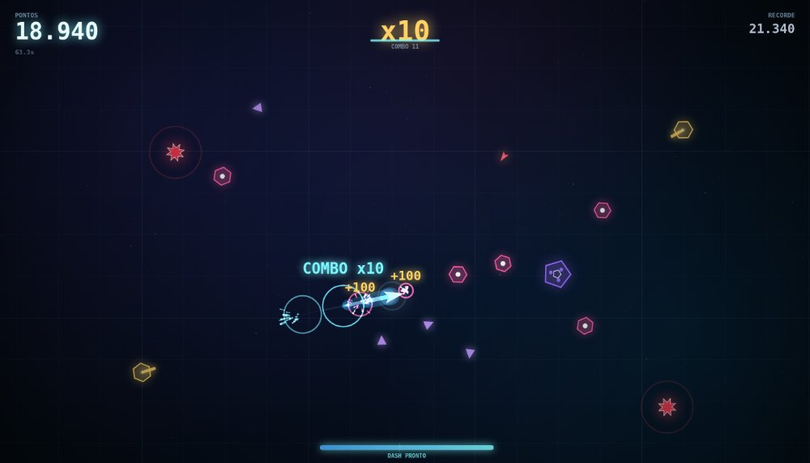

# NEON RIFT

Arena neon para navegador. Você não atira, não anda e não pula: **seu único movimento é o dash**.

Atravesse a horda para destruí-la, encadeie abates para multiplicar os pontos e recarregue a
energia matando. Errou o tempo? A horda te encosta e acabou. É uma run curta, um reinício
instantâneo e um recorde pessoal te provocando.



## Como jogar

| Ação | Desktop | Celular |
| --- | --- | --- |
| Dash | clique / `ESPAÇO` | toque na tela |
| Iniciar / reiniciar | `ESPAÇO`, `ENTER` ou clique | toque em JOGAR |
| Pausar | `ESC` / `P` | botão II |
| Som | `M` | botão 🔊 |

O dash vai na direção do cursor (no celular, na direção do toque) e custa energia. A barra
embaixo mostra a recarga: o marcador indica o mínimo para dar o próximo dash.

### Regras de ouro

- **Dash = ataque e defesa ao mesmo tempo.** Você fica invulnerável enquanto desliza e destrói
  tudo que atravessa (inclusive tiros).
- **Cada abate devolve energia.** Matar em sequência é o que mantém você vivo.
- **Minas vermelhas e tiros não podem ser atravessados.** Mina = morte no contato, mesmo em dash.
- **Combo** sobe a cada abate e vale por 2,6 s. O multiplicador vai até **x10** (pontos = base × mult).
- **SURTO** a cada 24 s: um cerco de inimigos fecha em volta de você. Não há para onde fugir, só
  para atravessar.

### Inimigos

| | Tipo | Comportamento |
| --- | --- | --- |
| 🩷 | **Drone** | persegue devagar, morre no dash |
| 🟣 | **Divisor** | lento e grande, ao morrer solta 3 mini-drones |
| 🟪 | **Mini** | pequeno e rápido, ótimo para manter o combo |
| 🔴 | **Mina** | deriva e quica nas paredes; **não** pode ser atravessada |
| 🟡 | **Torreta** | mira e atira; o tiro é destrutível com dash |

A dificuldade escala com o tempo: intervalo de spawn cai de ~1 s para 0,3 s e a velocidade dos
inimigos quase triplica nos primeiros 100 segundos. A partir de 12 s entram divisores, 22 s as
minas e 36 s as torretas.

## Rodar

Sem dependências, sem build.

```bash
npm start          # http://localhost:8000
# ou
python3 -m http.server 8000
```

Também funciona aberto direto pelo `index.html` em navegadores que permitem módulos via `file://`
— o normal é servir por HTTP.

### Teste headless

```bash
npm test
```

Roda o jogo sem navegador (canvas e DOM falsos) por alguns milhares de frames, verifica NaN,
limites de energia, número de inimigos e o ciclo de morte/reinício.

## Estrutura

```
index.html        markup das telas (menu, game over, pausa)
styles.css        HUD das telas, tipografia e neon
js/main.js        bootstrap, entrada (mouse/toque/teclado), loop principal
js/game.js        estado do jogo, dash, spawn, colisões, score, HUD do canvas
js/entities.js    inimigos, tiros e desenho do jogador
js/fx.js          partículas, anéis, textos flutuantes, screen shake, hitstop
js/audio.js       todos os sons e a trilha sintetizados com WebAudio (zero assets)
js/util.js        matemática e formatação
server.mjs        servidor estático mínimo em Node (sem dependências)
tools/smoke.mjs   teste de fumaça headless
```

Tudo é desenhado em um único `<canvas>`, com resolução ajustada ao `devicePixelRatio`. Não há
imagens, fontes ou áudios externos: os gráficos são formas e gradientes, e a música é um
sequenciador procedural (bumbo, hats, baixo e arpejo em Lá menor a 134 BPM) que acompanha a
intensidade da run.

O recorde e as preferências ficam no `localStorage`.
